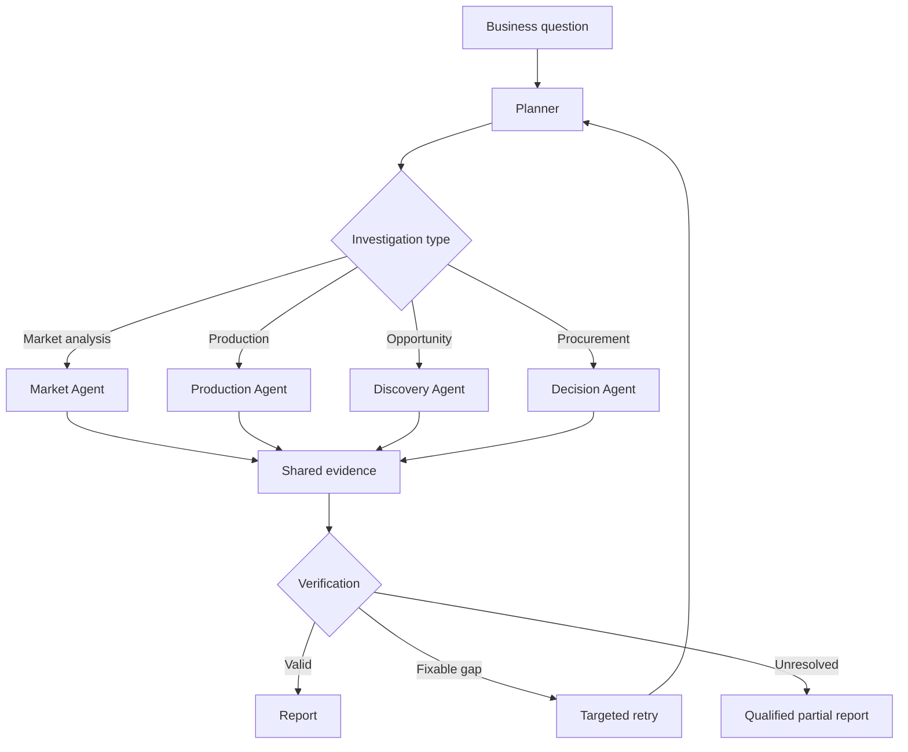

# TradeAtlas — India Agricultural Intelligence MVP

Project implementation plan · Version 1.0 · 11 November 2026

*Editorial note: The Sprint 1 checklist and closing roadmap were reconstructed from the surrounding project discussion because the export omitted the checklist and cut off the end of the original plan.*

**Decision: Start with AGMARKNET + UPAg, prove the groundnut use case, and evaluate e-NAM after the MVP works.**

## Product at a glance

**Commodity sourcing and market intelligence** for Indian agricultural traders, food processors and procurement teams. Help users compare wholesale prices, reported arrivals, producing regions, seasonality and sourcing risks, with evidence for each recommendation.

| Decision | MVP scope |
| --- | --- |
| Data | AGMARKNET for market observations; UPAg for crop production and seasonality |
| First commodity and geography | Groundnut in Gujarat and Rajasthan |
| Expansion | Reuse the pipeline for soybean in Madhya Pradesh and Maharashtra, then add mustard once coverage and mappings pass the same checks |
| Workflows | Market Explorer, Opportunity Discovery, AI Investigation, and Forecast & Decision Lab |

## 1. Scope: what we are and are not building

| In the MVP | Later expansion |
| --- | --- |
| Indian wholesale commodity prices | e-NAM actual traded quantities |
| Market arrival patterns | International import/export statistics |
| State and district crop production | Supplier and company networks |
| Market opportunity discovery | Live freight and warehouse availability |
| Sourcing-region comparisons | Global supply-chain disruptions |
| Price forecasting and anomaly detection | End-to-end shipment tracing |
| LangGraph, agents, MCP and evaluation | Broader multi-commodity intelligence |

Start with Gujarat and Rajasthan for groundnut. Madhya Pradesh and Maharashtra enter the initial footprint with the soybean portability check. Prioritize Rajasthan when profiling mustard; add markets and states where coverage supports useful comparisons.

**Critical business limitation:** AGMARKNET arrivals are not actual sales, and UPAg production does not establish inventory available for purchase. The first product will provide sourcing intelligence and decision support, not guaranteed purchase opportunities.

---

## 2. Data sources and access

Use a prepared repository containing both AGMARKNET and UPAg extracts to establish the first repeatable development baseline.

**Dataset A — AGMARKNET**

Prices, arrivals, commodity varieties, grades, markets and geography.

[Government data catalog](https://data.gov.in/catalog/current-daily-price-various-commodities-various-markets-mandi)

**Dataset B — UPAg**

Crop production, area, yield, crop season and historical agricultural estimates.

[Official API documentation](https://data.upag.gov.in/docs)

The AGMARKNET government catalog covers daily wholesale prices. UPAg documents statewise and districtwise Area, Production and Yield (APY) endpoints through its authenticated API. The prepared UPAg files came from portal report callbacks; the [collector notes](https://github.com/herrrickshaw/india-mandi-arrivals/blob/main/docs/upag_api.md) describe those callbacks as an internal interface that can change. Use the extracts first and verify approved access before depending on any refresh route.

### Initial files

| File | Grain | Coverage described by publisher |
| --- | --- | --- |
| `data/agmarknet/state_monthly.csv.gz` | State × commodity × month | Jan 2019–Oct 2026 |
| `data/agmarknet/market_daily_sample.csv.gz` | Market × commodity × sampled date | Nov 2025–Oct 2026, about every sixth day |
| `data/agmarknet/masters/*.csv.gz` | Commodity, market, district, state, variety, grade and unit | Reference tables |
| `data/upag/apy_state.csv.gz` | State × crop × season × crop year | 1997–98 to 2025–26; latest figures include advance estimates |
| `data/upag/apy_district.csv.gz` | District × crop × season × crop year | 2015–16 to 2024–25 |
| `data/upag/crop_calendar.csv.gz` | State × crop × month | Sowing and harvest reference |

[Prepared dataset repository](https://github.com/herrrickshaw/india-mandi-arrivals)

Use the state-monthly series for long-term trends and the sampled market observations for exploratory comparisons with visible coverage. Test a separate market-level source before offering detailed daily analysis. Never use the sampled file as a complete daily series for forecasting or treat unsampled days as zero.

### Market API routes worth implementing

The independently documented AGMARKNET 2.0 endpoints include:

| Endpoint | Purpose |
| --- | --- |
| `GET /daily-price-arrival/filters` | Market, commodity, variety and geography masters |
| `POST /dashboard-data/` | Market-level and state-level reporting views |
| `GET /price-trend/wholesale-prices-monthly` | Historical monthly prices |
| `GET /price-trend/wholesale-arrivals-monthly` | Historical monthly arrivals |
| `GET /price-trend/varietywise-prices-monthly` | Variety-level prices |

Base URL: `https://api.agmarknet.gov.in/v1/`

These routes come from community testing of the AGMARKNET application. They are candidates to probe, not guaranteed public API contracts. Verify response grain, dates, units, pagination and rate limits for the chosen reports. Use supported access for routes that require authentication or CAPTCHA. See the [community AGMARKNET endpoint audit](https://github.com/herrrickshaw/india-mandi-arrivals/blob/main/docs/agmarknet_api.md).

An alternative documented route is the [CEDA agricultural market API](https://api.ceda.ashoka.edu.in/documentation/), including `POST /agmarknet/prices` and `POST /agmarknet/quantities`.

**Initial data-source rule:** use prepared CSVs for the first development baseline, then select one approved API refresh route after testing actual responses. Avoid building multiple competing ingestion pipelines.

## 3. What makes the application useful?

Build four connected business workflows.

### Market Explorer

Compare wholesale prices, arrivals, locations, varieties and historical trends. Drill down from states to markets where coverage permits.

### Opportunity Discovery

Proactively identify unusual price differences, seasonal patterns, changes in market arrivals and potential sourcing regions. Each discovery has an explanation and quality score.

### AI Investigation

Ask a business question. Agents investigate market conditions, production, anomalies and competing explanations, then produce an evidence-backed report.

### Forecast & Decision Lab

Forecast prices, compare purchasing strategies and test assumptions such as future prices, transport costs and required quantities.

### Our flagship business scenario

A Gujarat-based edible-oil processor asks:

> "We need 100 tonnes of groundnut. Which sourcing regions should we investigate over the next three months? Compare historical prices, market arrivals, production patterns and price risks."

The platform should determine which data is available, investigate relevant regions, calculate historical prices and seasonal patterns, estimate future price ranges, and produce a shortlist of markets worth contacting.

The recommendation must state that actual quantities, grades, supplier availability and transportation quotations still need confirmation.

This single scenario is enough to demonstrate real multi-agent collaboration without inventing dozens of artificial functions.

---

## 4. The agent architecture we will build

Use **LangGraph with four specialist agents, one planner and a verification layer**.

**User question / Opportunity alert**

Business objective, commodity, geography, period and constraints

**Planner & Router**

Select the workflow, required tools and evidence

**Evidence & Calculation Verifier**

Units, time alignment, coverage, statistical validity and unsupported conclusions

**Business investigation report**

Findings · Forecasts · Risks · Charts · Source evidence

| Component | Responsibility |
| --- | --- |
| Planner & Router | Resolve the objective, commodity, geography, period and constraints; select the smallest sufficient workflow. |
| Market Agent | Analyze AGMARKNET prices, arrivals, coverage, trends and comparable markets. |
| Production Agent | Analyze UPAg area, production, yield, crop calendars and estimate status. |
| Discovery Agent | Investigate anomalies, seasonal patterns and sourcing signals; record competing explanations. |
| Decision Agent | Invoke forecasting and scenario tools; compare purchasing choices using stated assumptions. |
| Evidence & Calculation Verifier | Check original records, aggregation, units, date alignment, coverage and the claims drawn from them. |

### Conditional graph



For complex questions, the market and production agents can execute in parallel. For a simple question such as "What was Gujarat's monthly groundnut price trend?", we should answer directly with SQL rather than invoke all four agents.

**Agent design principle:** only the planning, investigation and synthesis layers need LLM reasoning. Calculations, forecasting, filtering, data validation and scenario optimization should use deterministic tools.

### Shared state

The investigation state should contain:

```python
class InvestigationState(TypedDict):
    question: str
    business_context: dict
    commodity_ids: list[str]
    geography_ids: list[str]
    plan: list[dict]
    market_evidence: list[dict]
    production_evidence: list[dict]
    discoveries: list[dict]
    forecast_results: dict
    scenario_results: dict
    source_references: list[dict]
    assumptions: list[dict]
    quality_flags: list[dict]
    retries: int
    final_report: dict
```

Set a maximum retry budget, preserve partial results when a specialist fails, and never allow an agent to silently substitute an unrelated commodity or unsupported date range.

## 5. MCP tools and reusable agent skills

Every specialist should have a small, well-defined toolset rather than unrestricted SQL and arbitrary external access.

| MCP tool | Responsibility |
| --- | --- |
| `market.search` | Find available markets and commodities |
| `market.price_history` | Retrieve price observations |
| `market.arrival_history` | Retrieve reported arrivals |
| `market.compare_regions` | Calculate comparable price/arrival metrics |
| `production.get_history` | Retrieve area, production and yield |
| `production.compare_states` | Compare crop production regions |
| `analytics.detect_anomalies` | Identify statistically unusual observations |
| `forecast.price` | Produce a validated price forecast |
| `scenario.compare_sourcing` | Compare supplied purchasing assumptions |
| `evidence.get_observation` | Return the original record and source |
| `evidence.check_coverage` | Verify data completeness and comparability |

Implement these as typed Python service functions first, then expose them through MCP. This keeps them independently testable and allows deterministic UI and API calls to reuse the same business logic.

### Skills to build

| Agent skill | What it teaches the agent |
| --- | --- |
| `commodity-market-investigation` | How to structure a market analysis |
| `regional-sourcing-evaluation` | How to shortlist sourcing regions without claiming guaranteed supply |
| `seasonality-and-anomaly-analysis` | How to investigate unusual market patterns |
| `production-market-reconciliation` | How to compare production and arrivals safely |
| `forecast-evaluation` | How to interpret forecasting uncertainty |
| `evidence-verification` | How to identify unsupported business claims |

LangGraph determines control flow; MCP provides the tools; skills provide reusable domain procedures. These are complementary, not competing frameworks.

---

## 6. Technology stack

| Layer | Initial choice | Reason |
| --- | --- | --- |
| Language | Python | Data science, ingestion and agents |
| Raw storage | CSV/GZIP + Parquet | Preserve and query source data |
| Analytics | DuckDB | Lightweight, efficient SQL over Parquet |
| Backend | FastAPI + Pydantic | Typed APIs and tool contracts |
| Agents | LangGraph | State, routing and retries |
| Tool interface | MCP Python SDK | Reusable, discoverable tools |
| Documents | Markdown + source documentation | Methodology and evidence |
| RAG | Hybrid retrieval, then pgvector if needed | Source definitions and methodology |
| Frontend | React + Vite + shadcn/ui | Component-based application |
| Charts | Apache ECharts or Recharts | Time series and comparison charts |
| Forecasting | StatsForecast / statsmodels | Reproducible statistical baselines |
| Validation | pytest + Pandera | Data and tool contracts |
| Evaluation | Custom golden tests + DeepEval/Ragas where suitable | Tool correctness and grounded responses |

Use DuckDB and Parquet as the initial analytical store. The first relationships are mostly commodity → state → district → market → observation, which SQL handles well.

We can still create a small evidence-aware graph and evaluate graph retrieval. Add Neo4j once actual multi-hop questions justify it, instead of duplicating relational data only to showcase graph technology.

Similarly, RAG is useful for methodology notes and government documents, but it should not be used to answer numerical questions that have exact SQL results.

### How the layers fit together

1. Pin the prepared source files and record their versions and hashes. Normalize source IDs and units, validate the rows, and write separate Parquet facts at their native grains.
2. Build DuckDB views for comparable metrics. Wrap them in typed Python services shared by FastAPI, the MCP server, and agent tools.
3. Let the React application call FastAPI for deterministic views and launch a LangGraph investigation for questions that need planning and synthesis. Send alerts into the same investigation flow with their filters and evidence attached.
4. Return structured findings, chart data, source records, quality flags, forecast intervals and user assumptions. Use document retrieval for definitions and methodology; route numeric questions to analytical tools.

## 7. Development roadmap

Build a usable investigation early and extend it through six milestones.

1. **Milestone 0 — Data proof and feasibility**

   Deliverable: two usable datasets, with source manifests and reproducible SQL.

   Download the prepared AGMARKNET and UPAg extracts. Profile their fields, historical coverage, prices, arrivals, production and join keys. Build three independently verifiable business insights.

   **Exit condition:** groundnut and soybean can be analyzed across multiple states with documented gaps and correct units.
2. **Milestone 1 — Analytical foundation**

   Deliverable: reusable data model, metrics and backend.

   Build canonical commodity and geographic dimensions, normalized Parquet tables, SQL views, data-quality checks and the FastAPI endpoints.

   **Exit condition:** the same question returns consistent results from SQL, backend APIs and tests.
3. **Milestone 2 — First working agent**

   Deliverable: an evidence-grounded conversational market analyst.

   Connect one LangGraph agent to the typed analytical tools. Implement planning, tool selection, evidence capture, errors, retry limits and structured reports.

   **Exit condition:** the agent can answer 20 benchmark questions without inventing unavailable data.
4. **Milestone 3 — Multi-agent investigation**

   Deliverable: end-to-end market and supply intelligence.

   Add Market, Production, Discovery and Decision specialists; parallel execution; shared state; verification; reusable skills and MCP tools.

   **Exit condition:** a complete sourcing investigation produces correct cross-source findings, assumptions and evidence.
5. **Milestone 4 — Product UI and decision lab**

   Deliverable: a usable web application.

   Build Market Explorer, opportunity cards, investigation workspace, charts, forecast comparisons and scenario inputs.

   **Exit condition:** a user can discover an opportunity and launch its investigation without retyping the context.
6. **Milestone 5 — Evaluation and release**

   Deliverable: a demonstrable, tested portfolio project.

   Add regression tests, historical forecasting backtests, single-agent versus multi-agent comparisons, adversarial questions, evidence verification, deployment and documentation.

   **Exit condition:** results are reproducible and the benefits and limitations of the agent architecture are measured.

For a solo project, I would provisionally allocate about six weeks, with data access and historical coverage as the main schedule risks. We should not treat the timeline as a commitment until Milestone 0 passes.

## 8. Data model and quality gates

Start with six analytical tables and three reference/evidence tables.

| Table | Key information |
| --- | --- |
| `fact_market_price` | Commodity, variety, market, period, price, unit |
| `fact_arrival` | Commodity, market/state, period, arrival quantity |
| `fact_crop_production` | Crop, state/district, season, year, production |
| `fact_crop_area_yield` | Crop, area, yield, estimate status |
| `fact_forecast` | Target series, prediction date, horizon and prediction |
| `fact_discovery` | Detected anomaly/opportunity, metrics and evidence |
| `dim_commodity` | Canonical product names, categories, source IDs |
| `dim_geography` | State, district, market and identifiers |
| `source_manifest` | Original source, file hash, download date, release, license |

Do not physically join market-month observations to crop-year production rows and then sum production repeatedly. Use separately aggregated facts and explicit time-alignment logic.

### Essential quality controls

| Risk | Validation |
| --- | --- |
| Different units | Convert ₹/quintal, tonnes, lakh tonnes and kg/ha explicitly |
| Missing market days | Calculate reporting coverage before comparisons |
| Incorrect commodity mapping | Confirm soybean/soyabean, groundnut and mustard varieties |
| Changed reporting coverage | Detect structural breaks rather than calling them demand changes |
| Advance production estimates | Preserve estimate version and publication status |
| Double counting | Keep state totals separate from market-level aggregations |
| Unsupported causality | Report possible explanations, not proven causes |

The AGMARKNET community audit specifically documents inconsistent arrival totals between certain report types and a change in reporting coverage around November 2025. We should use this as an explicit quality regression case rather than blindly trusting whichever query returns the most records. See the [community AGMARKNET endpoint audit](https://github.com/herrrickshaw/india-mandi-arrivals/blob/main/docs/agmarknet_api.md).

## 9. Objective evaluation strategy

Our most important differentiation should be **a reliable agentic investigation**, not the number of agents.

| Test | Baseline | Metric |
| --- | --- | --- |
| Price and arrival calculations | Reference SQL | Numerical accuracy |
| Commodity and geographic joins | Validated mappings | Join correctness and coverage |
| Opportunity detection | Simple price-spread ranking | Precision of historical signals |
| Price forecasting | Seasonal naive model | MASE, MAE, interval coverage |
| Cross-source investigations | Precomputed SQL report | Fact and evidence correctness |
| Single vs multi-agent | Identical tools and datasets | Quality, latency, cost |
| RAG | Keyword retrieval | Correct methodology citations |
| Unsupported questions | Expected abstention | False-claim rate |

Build an initial set of 50 evaluation questions, divided between straightforward numeric questions, multi-source investigations, ambiguous questions, and questions that should produce a qualified answer.

For forecasting, we must backtest using historical information available at the prediction date, especially where production estimates were revised later.

A multi-agent version should only replace the simpler baseline where it demonstrably improves results.

---

## 10. Sprint 1 — Groundnut Data Proof

Scope: groundnut, Gujarat and Rajasthan. Then test the same pipeline on soybean in Madhya Pradesh and Maharashtra.

### Sprint acceptance checklist

- [ ] Pin and download the prepared AGMARKNET and UPAg extracts. Record the source and revision, retrieval date, file hash and applicable terms in the source manifest.
- [ ] Profile prices, arrivals, APY, and crop-calendar records for groundnut in Gujarat and Rajasthan. Record available periods, reporting markets, missing dates, estimate status, units and unique keys.
- [ ] Validate groundnut commodity, variety and geography crosswalks. Keep source IDs, document any exclusions, and distinguish crop-year estimates from calendar-month observations.
- [ ] Normalize the selected facts to Parquet and create repeatable DuckDB views. Check units, duplicates, missing values, and the November 2025 coverage break. Keep state totals separate from aggregations of market rows.
- [ ] Produce three reproducible SQL results: comparable state-month price and seasonal patterns; reported arrival patterns and market coverage; and state or district production context aligned to the crop year. Attach input versions, filters, and caveats to each result.
- [ ] Probe candidate AGMARKNET refresh routes on a small date window. Check comparable coverage, reporting units, pagination and repeatability. Record whether the MVP should remain on pinned extracts while access is resolved.
- [ ] Run the same ingestion and analytical checks for soybean in Madhya Pradesh and Maharashtra. Document differences in coverage, mappings and quality before adding mustard.
- [ ] Save the SQL, a data profile and a short sourcing report. Include what a procurement team still needs to verify directly: quantities, grades, supplier availability and freight quotes.

**Definition of done**

We can generate a reproducible report comparing historical groundnut prices, market arrivals and crop production, with source references and clearly identified data limitations.

### Proposed repository structure

```text
tradeatlas/
├── configs/
│   ├── sources.yaml
│   └── commodities.yaml
├── data/
│   ├── raw/
│   ├── reference/
│   └── processed/
├── src/tradeatlas/
│   ├── ingestion/
│   ├── models/
│   ├── quality/
│   ├── analytics/
│   ├── forecasting/
│   ├── mcp/
│   ├── agents/
│   │   ├── state.py
│   │   ├── planner.py
│   │   ├── market.py
│   │   ├── production.py
│   │   ├── discovery.py
│   │   ├── decision.py
│   │   └── verifier.py
│   ├── retrieval/
│   ├── graph/
│   └── api/
├── skills/
├── evals/
│   ├── golden/
│   └── results/
├── tests/
├── frontend/
├── docs/
└── pyproject.toml
```

The initial sprint only needs `ingestion`, `models`, `quality`, `analytics`, source configuration, tests and documentation. Add the API, agent graph, skills, MCP and product UI as their milestones begin.

## 11. Expansion after the MVP

| Order | Source | What it unlocks | Gate before adoption |
| --- | --- | --- | --- |
| 1 | [e-NAM historical trade dashboard](https://www.enam.gov.in/web/dashboard/Historical) | Reported traded quantity for participating mandis, distinct from market arrivals. Adds a measure of observed trade activity to sourcing investigations. | Test groundnut and soybean at selected mandis for populated traded quantities, historical coverage, usable units and join keys, and an approved, repeatable access route. Keep e-NAM coverage explicit; it does not cover every mandi or sale. |
| 2 | [UN Comtrade](https://comtradeplus.un.org/) | International import and export trends, supplier concentration and alternative sourcing by country and product. Start the palm-oil extension with crude palm oil (`151110`) and other palm oil and its fractions (`151190`) as separate products. | Confirm reporter and partner coverage, classification versions, quantity versus value, frequency and revisions. Keep country-level trade context separate from domestic market facts. |
| 3 | [Trase Indonesia palm oil supply chain](https://trase.earth/open-data/datasets/supply-chains-indonesia-palm-oil) | Historical upstream exposure through producing regions, mills, refineries and trading groups where supported by the release. Provides a reason to test graph retrieval on actual multi-hop questions. | Pin the release and review its methodology and data-use terms. Align country, product, year, reporting direction and quantity definitions before comparing to Comtrade; Trase uses crude palm oil equivalents and includes modeled relationships. Do not infer individual shipments or current supplier availability. |

Start with the Groundnut Data Proof. Use its coverage report and reproducible results to decide how far the product can go at market level before implementing the first agent.
